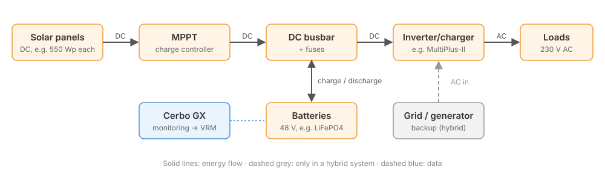
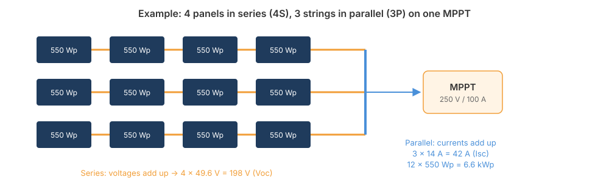

# A. Background & research: PV (solar power)

This page explains the basic ideas you need before you can design or size a PV system.

## How does a PV system work?

1. **Solar panels** turn sunlight into **direct current (DC)** electricity. The stronger the sunlight, the more power they produce; at night they produce nothing.
2. The **charge controller (MPPT)** sits between the panels and the batteries. It makes sure the panels always work at their best operating point and that the batteries are charged safely.
3. The **batteries** store the energy, so you can use it in the evening, at night or on cloudy days.
4. The **inverter** turns the DC from the batteries into **alternating current (AC)** of 230 V, the same as a normal socket. Most appliances need AC.
5. In a **hybrid** system, the inverter is also connected to the **grid or a generator**. When the sun and the battery are not enough, the grid takes over, and it can also charge the battery.
6. A **monitoring device** (in Humasol projects usually a Victron Cerbo GX) collects all data and sends it to the internet, so the follow-up team can check the system from Belgium.

## Power and energy: W versus Wh

This is the most important distinction in sizing:

- **Power (W or kW)** is how much electricity something uses *at one moment*. A 100 W laptop uses 100 W while it is on.
- **Energy (Wh or kWh)** is power *multiplied by time*. That laptop used for 5 hours uses 100 W × 5 h = **500 Wh = 0.5 kWh**.

You need both: the **energy** per day determines how many panels and how much battery you need; the highest **power** at one moment determines how large the inverter must be.

## Watt-peak (Wp) and peak sun hours

- A panel's **watt-peak (Wp)** is the power it delivers under standard test conditions (strong sun of 1000 W/m², 25 °C). A 550 Wp panel produces about 550 W at noon on a clear day, and less at other times.
- **Peak sun hours (PSH)** turn a whole day of changing sunlight into the equivalent number of hours of that standard sun. If a site has 5 peak sun hours, a 550 Wp panel produces roughly 550 W × 5 h = 2.75 kWh per day, before losses.
- Peak sun hours depend on the place and the **month**. Always size for the **worst month** (usually the rainy season), otherwise the system will fall short exactly when it is needed. You can find the data with PVGIS or similar tools.

## Losses

In practice a system never delivers the theoretical value: heat lowers the panel output, cables and the inverter lose some energy, and dust covers the panels. Humasol teams therefore use a **safety or loss factor**: for example, the Chaulmoogra team assumed that only 75 % of the theoretical energy is really available (factor 0.75).

## Series and parallel

Panels are connected in **strings**:

- **In series** (+ of one panel to – of the next) the **voltages add up**, the current stays the same.
- **In parallel** (strings next to each other) the **currents add up**, the voltage stays the same.

The charge controller has a maximum input voltage and a maximum current, so the way you connect the panels must fit the controller. See [4. Sizing](technology/sizing.md), step 5.

## AC versus DC

Panels and batteries work with DC, appliances and the grid with AC. That is why you need an inverter, and why you should check for each appliance whether it runs on AC or DC.

## When is PV a good choice?

Humasol teams chose PV when:

- there is **no grid connection** ([Kiyodel](https://drive.google.com/file/d/124zqvYch7JHpEYUP_ul1__plQ9Rwe_94/view), [Chaulmoogra](https://drive.google.com/file/d/1CjcOCPlSrWIydsPOc8KnPEB9xlv46_OT/view));
- the grid is **unreliable**, with long blackouts or voltage surges that damage appliances ([Kudimba](https://drive.google.com/file/d/1Y8qTqc43MzCeUmgzvBQeKE0Wt4mrtfGtME4QmEWAmo8/view), [Apida](https://drive.google.com/file/d/1c8-2AVDGSzAgYXFXR_jMqJk__LChXEvR/view), [Gitaru Marigu](https://drive.google.com/file/d/1D3iP_NHe1bnwG8g8spbsb6MS3Cgx5PEH/view), [Emergi](https://drive.google.com/file/d/1dvwuWhsSH8iRaCqRwZrG4B46ZKS-dGI-/view));
- electricity or diesel is **expensive** ([Hart voor Senegal](https://drive.google.com/file/d/1N-7zGPKSlN5lW41Qz10BElMGGCMtTnW9/view), [Apida](https://drive.google.com/file/d/1c8-2AVDGSzAgYXFXR_jMqJk__LChXEvR/view)).

## Background literature and research

- *PV for Dummies*: used by many Humasol teams as a starting point.
- The final reports of earlier Humasol PV projects: see the [list of past projects](index.md#past-projects-with-this-technology).
- Research done in Humasol projects: vehicle-integrated solar roofs and swappable batteries ([Emergi](https://drive.google.com/file/d/1dvwuWhsSH8iRaCqRwZrG4B46ZKS-dGI-/view)); using excess energy from solar pumps for induction cooking, and solar tracking ([SmartVillages](https://drive.google.com/file/d/1QIK5KLvXKEnRbaTRG-6JcUJ0Uqzeogeu/view)).
