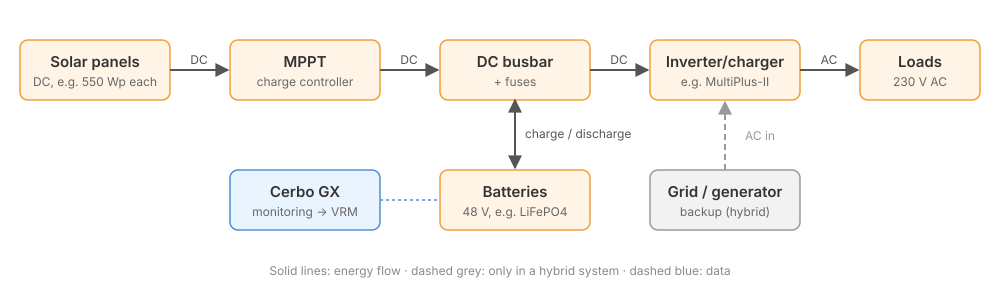

# B. Technology: PV (solar power)

## 1. How the parts work together

During the day, the panels produce DC power. The **MPPT charge controller** sends it to the **DC busbar**, a copper bar where all DC cables meet. From there the energy goes straight to the **inverter** to supply the loads, and whatever is left charges the **batteries**. In the evening and at night the panels stop producing and the batteries supply the inverter. In a **hybrid system**, the inverter switches to the grid or a generator when the battery gets too low, and it can also charge the battery from it.

Between all parts there are **fuses, switches and surge protection** to keep the system and the people safe. The **Cerbo GX** reads the data of all Victron devices and sends it to the online VRM portal.

## 2. Main components

| Component | Read this page for |
|---|---|
| [Solar panels](components/panels.md) | The parameters on a datasheet and how to choose a panel |
| [Charge controller (MPPT)](components/charge-controller.md) | How to check that a string of panels fits the controller |
| [Batteries](components/batteries.md) | Lithium versus lead-acid, depth of discharge, how much storage you need |
| [Inverter](components/inverter.md) | How to choose the inverter power, and inverter/chargers for hybrid systems |

## 3. and 4.

- [3. System types](system-types.md): off-grid or hybrid, and when to choose which
- [4. Sizing](sizing.md): the complete step-by-step method, worked out for Emergi

**On the Drive:** [Sizing tool](https://drive.google.com/) · [Central supplier list](https://drive.google.com/) (filter on *PV*) *(add links)*
