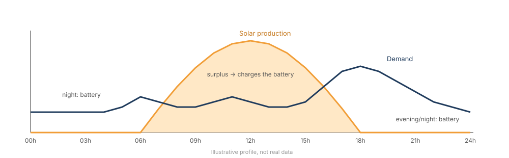
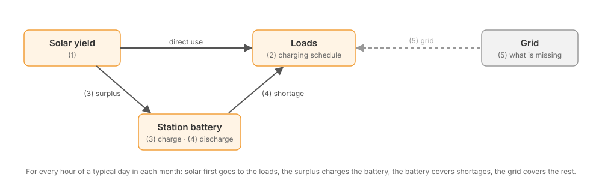
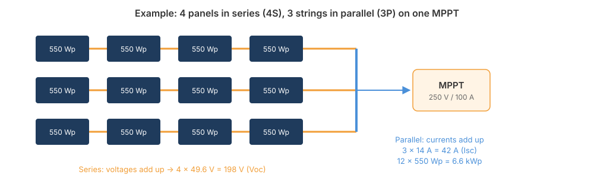
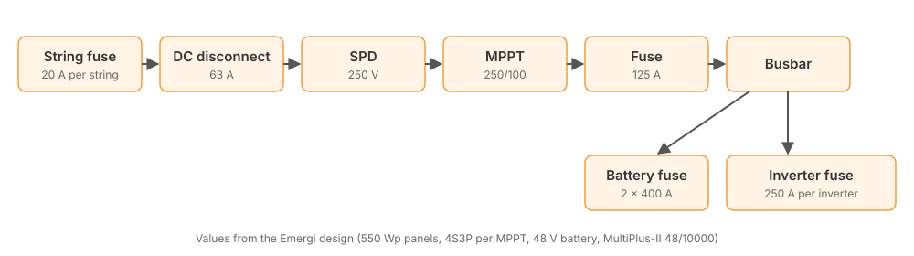

# 4. Sizing

This page takes you through the whole sizing process, step by step. Each step explains **what** you do and **why**, and shows the numbers of a real Humasol project: the **[Emergi](https://drive.google.com/file/d/1dvwuWhsSH8iRaCqRwZrG4B46ZKS-dGI-/view)** service station in Monrovia, Liberia (2025-26).

!!! info "About the Emergi example"
    Emergi runs a fleet of electric three-wheeler taxis (kehkehs). They are charged at a service station with a PV system (8.8 kWp, 20.4 kWh battery, one 10 kW inverter) connected to an unreliable and expensive grid. The fleet grows from 15 to 28 vehicles, so the station had to be expanded. Because the budget was limited, the team designed the full expansion and built it in **two phases**.

## Overview of the steps

1. Find out how much energy is needed, and when
2. Look at the sunlight on the site
3. Make a first estimate by hand
4. Refine with an hourly model and choose the final size
5. Choose the panels, connect them in strings and check the charge controllers
6. Choose the inverter
7. Check the battery current
8. Size the cables
9. Add protection devices

---

## Step 1: How much energy is needed, and when?

Everything starts with the **load profile**: which appliances are used, how much power they draw, and **at what time**. Make it together with the partner; they know best how the site is used.

For each appliance: power (W) × number × hours per day = energy per day (Wh). The sum is the **daily energy demand**. But also note the **time of use**, because energy used during the day can come straight from the panels, while energy used at night has to come from the battery.

**Emergi.** The loads are the vehicles that are charged. The team made a **charging schedule**: the vehicles are divided into three groups that come back to the station at different times, so they are not all charged at once. Each group's status is planned per hour (driving, charging or standing still). Battery-swap vehicles leave their empty batteries at the station in the morning, so those are charged during the day, when the sun shines. From this schedule they knew, for every hour, how much power the station needs.

## Step 2: How much sun is there?

Find the solar resource for the site **per month**: peak sun hours, or better, hourly production data (e.g. from PVGIS or SoDa). The **worst month** decides whether the system is large enough.

This figure shows the basic problem: the sun produces in the middle of the day, but demand is often highest in the evening. The surplus during the day must charge the battery for the evening and night.

**Emergi** used hourly solar-yield data for every month of the year received from a TU Delft team. The worst month is **July** (rainy season), the best is **February**.

## Step 3: A first estimate by hand

Before any detailed model, make a quick estimate. For smaller systems this is often already close.

**Number of panels**

N = daily energy (Wh) ÷ (peak sun hours × Wp per panel × loss factor)

**Battery capacity (first estimate, off-grid)**

C (Ah) = daily energy (Wh) ÷ (battery voltage × DoD)

!!! example "Hand calculation from the Chaulmoogra project"
    Daily demand 16 856 Wh, 5 peak sun hours in the worst month, panels of 595 Wp, loss factor 0.75:
    N = 16 856 ÷ (5 × 595 × 0.75) = 7.55 → **8 panels**.
    Battery at 48 V with a DoD of 90 %: about **384 Ah, or 18.5 kWh**.
    After a simulation the team chose **14 panels** and a **15 kWh** battery: more panels to get through rainy days, and less battery because the panels supply most loads directly during the day.

## Step 4: Refine with an hourly model

A hand calculation uses averages. In reality production and demand change every hour, and that decides whether the battery is empty at 3 a.m. That is why larger projects simulate **every hour of a typical day in each month**.

**Emergi** built a custom **Excel model**. For every hour it calculates:

- **(1)** the **solar yield** of the new installation;
- **(2)** the **energy use** of the station, from the charging schedule;
- **(3) and (4)** how much energy goes **into or out of the battery**, limited by the inverter power, and so the **battery level** at every hour;
- **(5)** how much **grid electricity** is still needed.

The model then tries **different combinations** of number of panels and battery size, and for each one calculates the **daily grid cost, the investment cost and the payback time**. The best combination was chosen from those three numbers.

**Result.** The full expansion brings the station to about **75 kWp** of PV, **96.9 kWh** of battery, **12 MPPTs** and **3 inverters of 10 kW**. Even then, the station still needs about **eight hours of grid electricity** somewhere between 16:00 and 06:00. Becoming fully independent from the grid would be too expensive. In July there is just enough sun to charge the battery, but never enough to fill it completely.

Because of the budget, Humasol built **phase 1** (48 panels of 550 Wp = 26.4 kWp, 4 MPPTs, 2 inverters, 4 × 5.1 kWh battery modules). Emergi will build **phase 2** later.

!!! tip "Other Humasol tools"
    Earlier teams also wrote **MATLAB simulation scripts** with hourly irradiance data that compare cost against hours with an empty battery (used in [Chaulmoogra](https://drive.google.com/file/d/1CjcOCPlSrWIydsPOc8KnPEB9xlv46_OT/view) and [Ekisande](https://drive.google.com/file/d/1Uph_8Rsgz2uiQyqi_6xViWToYrFWDytj/view)). Ask Follow-up or check those reports before building your own model.

## Step 5: Panels, strings and charge controllers

Now you know the total PV power. Next, decide how to connect the panels to the charge controllers.

**Emergi** used panels of 550 Wp (Voc 49.62 V, Isc 14.03 A) and Victron SmartSolar MPPT 250/100 controllers. Per controller: **4 panels in series, 3 strings in parallel (4S3P)** = 12 panels = 6.6 kWp.

The three checks for each controller:

1. **Voltage.** One string: 4 × 49.62 V = **198.5 V**, below the **250 V** limit. Keep a margin, because on a cold morning the voltage rises a few percent.
2. **Power.** The recommended maximum is 5.8 kW for a 48 V battery. Victron allows about 130 % oversizing: 1.3 × 5.8 = **7.54 kW**. The 6.6 kWp array stays below it. The theoretical current (6.6 kW ÷ 48 V ≈ 140 A) is higher than 100 A, but panels rarely reach full Wp and the controller limits its output to 100 A, so that is acceptable. The design was also checked with the Victron MPPT calculator.
3. **Short-circuit current.** 3 strings × 14.03 A ≈ 42 A, within the controller limit.

A 5S2P layout would also have been possible, but then an extra controller would have been needed.

## Step 6: The inverter

The inverter is sized on the **highest power at one moment**. At Emergi, the maximum daytime demand is about **27 kW**. Three extra 10 kW inverters would cover it completely, but the demand is above 24 kW for only about three hours a day. The team therefore installed **two extra inverters** and lets the grid cover those peak hours. That is a conscious choice: if the grid fails exactly at that time, not all vehicles can be charged at once.

On the DC side, one 10 kW inverter (efficiency 0.96) draws: 10 000 W ÷ (0.96 × 48 V) = **217 A**, so a **250 A fuse** is placed between busbar and inverter.

## Step 7: The battery current

Check both directions and design for the largest:

- **Charging:** 6 controllers × 100 A = 600 A from the sun, plus the grid charger of the inverter: 6800 W ÷ (0.96 × 48 V) ≈ 148 A. Total ≈ **748 A**.
- **Discharging:** 3 inverters × 217 A = **651 A**.

748 A is too much for one cable, so the battery is connected with **two parallel cables of 95 mm²**, each with a **400 A fuse**. Parallel cables must have the same length, otherwise the current is not shared evenly.

## Step 8: Cables

A cable must meet two conditions:

1. **Low voltage drop**, so little energy is lost. Emergi accepted at most **2 %** (Chaulmoogra used 2.5–3 %).
   Voltage drop: ΔV = 2 × L × ρ × I ÷ A, with L the length (m), I the current (A), A the cross-section (mm²) and ρ = 0.0225 Ω·mm²/m for copper. Then %ΔV = ΔV ÷ V × 100.
2. **Not too hot.** The heat in a cable is P = R × I², with R = ρ × L ÷ A. Emergi used a limit of **40 W per metre** of cable.

On the PV side, Chaulmoogra multiplied the current by **1.25 twice**: once because panels can give more current in strong sun, and once because cables should not carry more than 80 % of their rating continuously.

| Emergi cable | Current | Cross-section | Voltage drop |
|---|---|---|---|
| String → combiner (20 m) | 20 A | 6 mm² | 1.4 % |
| Combiner → MPPT (20 m) | 63 A | 16 mm² | 1.7 % |
| MPPT → busbar (4 m) | 100 A | 16 mm² | 2.2 % |
| Busbar → inverter (4 m) | 250 A | 50 mm² | 1.9 % |
| Busbar → battery (4 m) | 2 × 400 A | 2 × 95 mm² | 1.5 % |

## Step 9: Protection

The basic rule: **load current ≤ fuse rating ≤ cable capacity**. The fuse must be larger than the normal current, but smaller than what the cable can carry.

At **Emergi**, on the DC side:

- **String fuse** per parallel string: Isc × 1.25 = 14.03 × 1.25 = 17.5 A → **20 A** (below the panel's maximum series fuse of 25 A).
- **DC disconnect switch** between panels and MPPT, so the panels can be safely isolated: 3 strings × 17.5 A = 52.6 A → **63 A**.
- **Surge protection (SPD)** against lightning: 1.25 × string voltage ≈ 248 V → **250 V** SPD.
- **Fuses** between MPPT and busbar (125 A), busbar and inverter (250 A) and busbar and battery (2 × 400 A).

On the AC side, Emergi placed per inverter a **residual current device (RCD)** of 100–300 mA, a **circuit breaker (MCB)** and an **SPD**, and on each outgoing circuit an MCB and a **30 mA RCD** for personal protection where people plug in. The DC side is a **floating system**: neither + nor – is earthed, but all metal housings are connected to earth.

!!! warning "Follow the regulations"
    Emergi and Chaulmoogra followed the Belgian electrical regulations (AREI). Also check the local rules, and have the design checked by someone with electrical experience before you leave.

---

**Sizing tool:** [on the Drive](https://drive.google.com/) *(add link)* · Full calculations: [Emergi report](https://drive.google.com/file/d/1dvwuWhsSH8iRaCqRwZrG4B46ZKS-dGI-/view), [Chaulmoogra report](https://drive.google.com/file/d/1CjcOCPlSrWIydsPOc8KnPEB9xlv46_OT/view)
