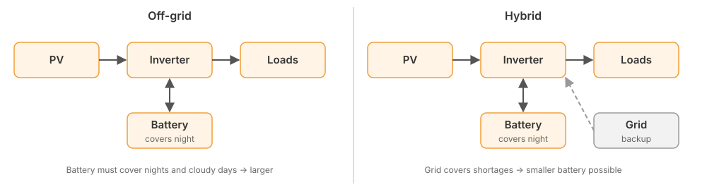

# 3. System types

## Off-grid

The system is the only source of electricity. Everything you use in the evening and at night must come from the battery, and on a cloudy day the panels must still produce enough. This means **more panels and a larger battery**, and good agreements on how to use the energy.

**Choose this when** there is no grid and none is expected soon. Examples: [Kiyodel](https://drive.google.com/file/d/124zqvYch7JHpEYUP_ul1__plQ9Rwe_94/view), [Chaulmoogra](https://drive.google.com/file/d/1CjcOCPlSrWIydsPOc8KnPEB9xlv46_OT/view), [Sandulika](https://drive.google.com/file/d/1HX6a3ktDhPPnuC4076rullBHeRJb9L2x/view).

**Tip:** in an off-grid system it helps a lot to **shift or reduce loads** after a cloudy day. The Chaulmoogra simulation showed that postponing non-essential use (phone charging, extra lighting, early-morning oven use) keeps the freezer running through nights when the battery would otherwise be empty.

## Hybrid

The system works together with the grid or a generator. The sun supplies most of the energy, the battery covers the evening, and the grid fills the gaps or covers peaks. The battery can be **smaller**, and the system can even start **without batteries**, adding them later ([Gitaru Marigu](https://drive.google.com/file/d/1D3iP_NHe1bnwG8g8spbsb6MS3Cgx5PEH/view)).

**Choose this when** a grid or generator exists but is unreliable or expensive. Examples: [Emergi](https://drive.google.com/file/d/1dvwuWhsSH8iRaCqRwZrG4B46ZKS-dGI-/view), [Ekisande](https://drive.google.com/file/d/1Uph_8Rsgz2uiQyqi_6xViWToYrFWDytj/view), [Hope for Girls & Women](https://drive.google.com/file/d/1Hf7LYZVS5rYBWHYoIerWkpYfLCCgrHsf/view).

In Victron systems you can set how far the battery may be discharged before the grid takes over (the "minimum state of charge", used in [Hope for Girls & Women](https://drive.google.com/file/d/1Hf7LYZVS5rYBWHYoIerWkpYfLCCgrHsf/view)).

## Without batteries (PV-direct)

Some loads can run directly on the sun, such as a **solar water pump** that pumps into a tank during the day. The tank then acts as the "battery". See [Water distribution](../../water-distribution/index.md).

## Design for growth

Sites often grow: more pupils, more patients, more vehicles. Leave room to **add panels, batteries or an inverter later** ([Kiyodel](https://drive.google.com/file/d/124zqvYch7JHpEYUP_ul1__plQ9Rwe_94/view), [Emergi](https://drive.google.com/file/d/1dvwuWhsSH8iRaCqRwZrG4B46ZKS-dGI-/view)): for example a charge controller with spare input voltage, battery modules that can be extended, and an inverter/charger that can later be connected to the grid.
